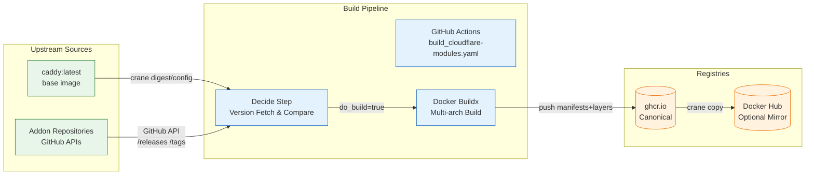
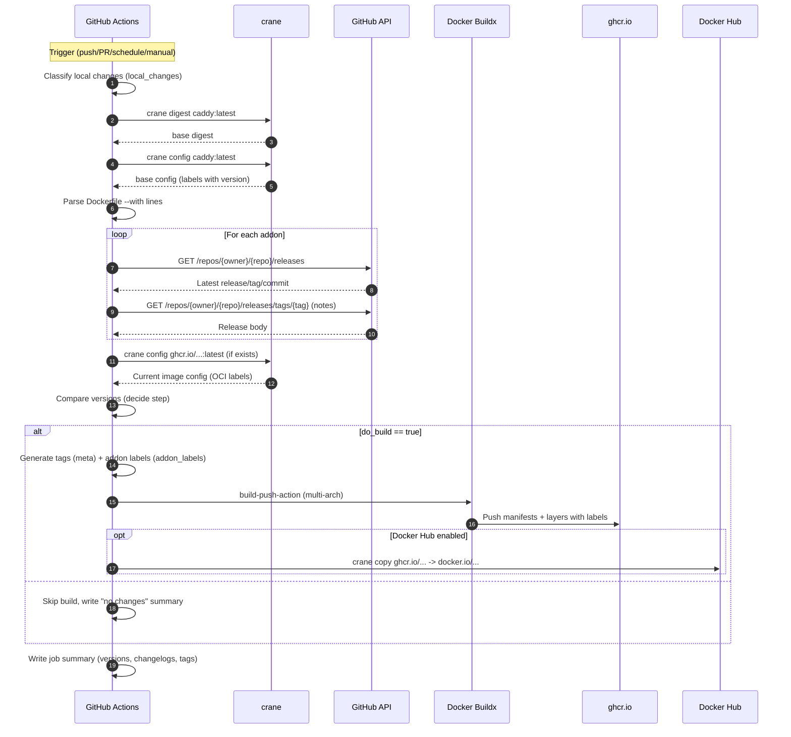

# Architecture Overview

## System Context

The system comprises three primary domains: **Upstream Sources** (Caddy base image and addon repositories), the **Build Pipeline** (GitHub Actions workflow with dynamic discovery), and **Registries** (GHCR as canonical, Docker Hub as optional mirror). OCI image labels serve as the traceability mechanism linking builds across runs.



## Core Components

### 1. Multi-Stage Dockerfile (`Dockerfile-cloudflare`)

**Build Stage** (`caddy:builder`):
- Uses `xcaddy` to compile Caddy with declared addons
- Each `--with` line adds a Go module at compile time
- Produces custom `/usr/bin/caddy` binary

**Final Stage** (`caddy:latest`):
- Copies only the compiled binary from builder
- Inherits Caddy's runtime configuration (entrypoint, user, etc.)
- Adds OCI labels for traceability

```dockerfile
# Build stage
FROM caddy:builder AS builder
RUN xcaddy build \
    --with github.com/caddy-dns/cloudflare \
    --with github.com/WeidiDeng/caddy-cloudflare-ip \
    --with github.com/fvbommel/caddy-combine-ip-ranges \
    --with github.com/lucaslorentz/caddy-docker-proxy/v2

# Final stage
FROM caddy:latest
COPY --from=builder /usr/bin/caddy /usr/bin/caddy
```

**Key Properties:**
| Property | Detail |
|----------|--------|
| Base builder | `caddy:builder` (official, includes Go toolchain + xcaddy) |
| Base runtime | `caddy:latest` (minimal, non-root user, proper entrypoint) |
| Addon declaration | `--with github.com/owner/repo[@version]` lines |
| Comment handling | Lines starting with `#` ignored by build and workflow parser |
| Version pinning | None — `xcaddy` fetches latest compatible at build time |
| Go major versions | Path suffix `/v2`, `/v3` is part of module path (not a tag) |

### 2. GitHub Actions Workflow (`.github/workflows/build_cloudflare-modules.yaml`)

Single `build` job on `ubuntu-latest` with concurrency group `${{ github.workflow }}-${{ github.ref }}` (cancels in-progress runs on same ref).

#### Trigger Conditions

| Trigger | Paths Filter | Behavior |
|---------|-------------|----------|
| Push to `main` | `Dockerfile-cloudflare`, `.dockerignore`, workflow file | Build + publish |
| Pull Request | Same as push | Validation build (no push) |
| Schedule | Daily `0 3 * * *` (03:00 UTC) | Check upstream, build if changed |
| Manual | `workflow_dispatch` with optional `force=true` | Build regardless of changes |

#### Job Phases

| Phase | Step ID | Purpose | Key Operations |
|-------|---------|---------|----------------|
| **Classify Changes** | `local_changes` | Detect local file changes | `git diff` base→head (PR) or before→current (push); outputs `image_inputs_changed`, `workflow_changed` |
| **Setup** | — | QEMU, Buildx, GHCR login | `docker/setup-qemu-action@v4`, `docker/setup-buildx-action@v4`, `docker/login-action@v4` (GHCR via `GITHUB_TOKEN`) |
| **Decide Build** | `decide` | Fetch upstream versions, compare with published image | ~400-line bash script: `crane digest/config` for base; GitHub API `/repos/{owner}/{repo}/releases` for addons; OCI label comparison; outputs `do_build`, versions, release notes, addon metadata |
| **Metadata** | `meta` | Generate tags and base labels | `docker/metadata-action@v6`: tags `latest`, `caddy-<ver>` |
| **Addon Labels** | `addon_labels` | Generate dynamic addon OCI labels | Reads `decide` outputs; produces `org.opencontainers.image.addon.N.name` + `.version` per discovered addon |
| **Build & Push** | — | Multi-arch build via Buildx | `docker/build-push-action@v7`: platforms `linux/amd64,linux/arm64,linux/arm/v7` (PR: amd64 only); cache `type=gha` |
| **Docker Hub Mirror** | `dockerhub_mirror` | Copy tags to Docker Hub (conditional) | `crane copy` for `latest` and `caddy-<ver>`; requires `DOCKERHUB_USERNAME` + `DOCKERHUB_TOKEN` secrets |
| **Summary** | — | Write job summary | Cats pre-rendered `/tmp/summary.md` to `$GITHUB_STEP_SUMMARY` |

#### Decide Step Detail (Core Logic)

The `decide` step implements the build decision algorithm:

```text
FORCED = true if:
  - workflow_dispatch with force=true
  - PR with image_inputs_changed OR workflow_changed
  - Push with image_inputs_changed

CHANGED = true if:
  - No current image exists (first build)
  - Caddy base digest changed (crane digest caddy:latest != stored org.opencontainers.image.base.digest)
  - Any addon version changed (GitHub API version != stored org.opencontainers.image.addon.N.version)

do_build = FORCED OR CHANGED
```

**Upstream Version Fetching:**
- **Caddy base**: `crane digest caddy:latest` + `crane config` → extract `org.opencontainers.image.version` label
- **Each addon**: GitHub API `GET /repos/{owner}/{repo}/releases?per_page=10` → first stable release; fallback to `/tags`; fallback to latest commit SHA on default branch
- **Release notes**: Fetched for Caddy and each addon; linked in job summary

### 3. Addon Discovery (Dynamic)

The workflow **parses the Dockerfile at runtime** to discover active addons — no hardcoded list:

```bash
grep -- '--with' Dockerfile-cloudflare | \
  while IFS= read -r line; do
    [[ "$line" =~ ^[[:space:]]*# ]] && continue
    [[ "$line" =~ --with[[:space:]]+([^[:space:]\\]+) ]]
    addon="${BASH_REMATCH[1]}"
  done
```

**Implications:**
- Adding a `--with` line automatically integrates it into version fetching, OCI labeling, and change detection
- Commented `--with` lines are ignored (enables easy toggling)
- Go major version suffix (`/v2`) is stripped for GitHub API calls (not part of repo path)

## Data Flow

The following sequence diagram shows the end-to-end data flow from upstream sources through the build pipeline to registries, with OCI labels as the traceability backbone.



**Caption:** End-to-end data flow from upstream version discovery through build decision, multi-arch build, and registry publishing.

## OCI Labels as Traceability Mechanism

Every published image carries a comprehensive set of OCI labels that enable **cross-run change detection** and **reproducible deployments**:

### Base Image Labels (Static + Dynamic)

| Label | Source | Purpose |
|-------|--------|---------|
| `org.opencontainers.image.base.name` | Hardcoded (`caddy:latest`) | Identifies base image |
| `org.opencontainers.image.base.tag` | From base image `org.opencontainers.image.version` | Semantic version for tagging |
| `org.opencontainers.image.base.digest` | `crane digest caddy:latest` | Immutable content hash for change detection |
| `org.opencontainers.image.base.version` | Same as base.tag | Redundant for tooling compatibility |

### Addon Labels (Dynamic, Per-Discovered-Addon)

For each addon discovered from Dockerfile `--with` lines (index `N` starting at 0):

| Label | Example |
|-------|---------|
| `org.opencontainers.image.addon.N.name` | `github.com/caddy-dns/cloudflare` |
| `org.opencontainers.image.addon.N.version` | `v1.2.3` |

Generated in `addon_labels` step — **no hardcoded addon count**.

### Legacy Label (Backward Compatibility)

| Label | Value |
|-------|-------|
| `org.opencontainers.image.cloudflare.version` | Cloudflare DNS module version (addon 0) |

Kept for existing tooling that may read this specific label.

### Standard OCI Labels

| Label | Value |
|-------|-------|
| `org.opencontainers.image.title` | `Caddy with additional modules` |
| `org.opencontainers.image.description` | `Caddy web server image with several additional modules baked in` |
| `org.opencontainers.image.url` | `https://caddyserver.com` |
| `org.opencontainers.image.documentation` | `https://caddyserver.com/docs` |
| `org.opencontainers.image.licenses` | `MIT` |
| `org.opencontainers.image.source` | `https://github.com/smoochy/caddy-modules` |

## Extension Points

| Extension | Mechanism |
|-----------|-----------|
| **Add a module** | Add `--with github.com/owner/repo` line to Dockerfile; workflow auto-discovers |
| **Pin addon version** | Append `@v1.2.3` to `--with` line (xcaddy syntax) |
| **Add registry** | Extend `registries` step + mirror step; add credentials as secrets |
| **Change platforms** | Modify `platforms` in `build-push-action` step |
| **Add build args** | Extend `build-push-action` with `build-args`; propagate to Dockerfile |
| **Custom triggers** | Add `on:` events (e.g., `repository_dispatch` for external triggers) |

## Invariants

| Invariant | Enforced By |
|-----------|-------------|
| Two-stage build: builder compiles, final only copies binary | Dockerfile structure |
| Addons declared via `--with` lines only | Dockerfile + workflow grep parser |
| Commented `--with` lines ignored | Build (Dockerfile) + workflow parser both skip `#` |
| Every build publishes `latest` + `caddy-<ver>` tags | `metadata-action` tag config |
| OCI labels capture base digest + all addon versions | `decide` + `addon_labels` + `build-push-action` labels |
| Docker Hub mirror only when secrets configured | `registries` step condition |
| PR validation builds never push | `push: ${{ github.event_name != 'pull_request' }}` |
| Concurrency cancels in-progress runs on same ref | `concurrency` group with `cancel-in-progress: true` |

## Related Pages

- [Cloudflare Modules Integration](../integrations/cloudflare-modules.md) — Module details and configuration
- [Dockerfile Structure](../operations/dockerfile.md) — Build stage, xcaddy, addon declaration
- [Image Tags & Publishing](../operations/image-tags.md) — Tag strategy, OCI labels, mirror flow
- [Build Pipeline Workflow](../workflows/build-pipeline.md) — Phase-by-phase workflow documentation
- [Quickstart](../quickstart.md) — Getting started with the image
