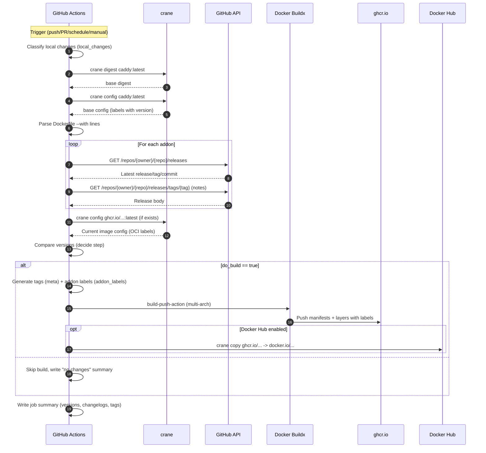

# Build Pipeline Workflow

## Workflow File
`.github/workflows/build_cloudflare-modules.yaml` (706 lines)

## Trigger Conditions

The workflow responds to four distinct trigger types, each with specific path filtering to prevent rebuilds for documentation-only changes.

| Trigger | Event | Paths Filter | Behavior |
|---------|-------|--------------|----------|
| **Push to `main`** | `push` | `Dockerfile-cloudflare`, `.dockerignore`, `.github/workflows/build_cloudflare-modules.yaml` | Full build + publish to GHCR + optional Docker Hub mirror |
| **Pull Request** | `pull_request` (targeting `main`) | Same as push | Validation build only (multi-arch `linux/amd64`); no push to any registry |
| **Schedule** | `schedule` (cron `0 3 * * *`) | N/A — no path filter | Daily 03:00 UTC upstream check; builds only if Caddy base or any addon changed |
| **Manual** | `workflow_dispatch` | N/A | Optional `force=true` input; builds regardless of upstream state |

**Path filtering rationale**: Only changes to the Dockerfile, `.dockerignore`, or the workflow file itself affect the produced image. Documentation, tests, and other repository files are excluded via `paths:` on `push` and `pull_request` triggers.

---

## Job: `build`

Runs on `ubuntu-latest` with concurrency group `${{ github.workflow }}-${{ github.ref }}` (`cancel-in-progress: true`). This cancels any in-progress run on the same ref (branch or PR), preventing queue buildup.

### Step 1: Classify Local Changes (`local_changes`)

Determines whether the triggering event modified files that affect the image build. Uses `git diff` between appropriate SHAs:

| Event | Compare From | Compare To |
|-------|--------------|------------|
| Pull Request | `github.event.pull_request.base.sha` | `github.event.pull_request.head.sha` |
| Push | `github.event.before` | `github.sha` |

```bash
# Core logic (simplified)
changed_files="$(git diff --name-only "$compare_from" "$compare_to")"

# Dockerfile* or .dockerignore changed
printf '%s\n' "$changed_files" | grep -Eq '^(Dockerfile[^/]*|\.dockerignore)$'
# → sets image_inputs_changed=true

# Workflow file itself changed
printf '%s\n' "$changed_files" | grep -Fxq ".github/workflows/build_cloudflare-modules.yaml"
# → sets workflow_changed=true
```

**Outputs**:
- `image_inputs_changed` — `true` if `Dockerfile-cloudflare` or `.dockerignore` modified
- `workflow_changed` — `true` if the workflow file modified

These outputs feed directly into the **forced build** logic in the `decide` step.

---

### Step 2: Setup (QEMU, Buildx, GHCR Login)

Standard Docker Buildx multi-arch setup:
- `docker/setup-qemu-action@v4` — QEMU for cross-platform emulation
- `docker/setup-buildx-action@v4` — Buildx builder instance
- `docker/login-action@v4` — GHCR login using `GITHUB_TOKEN` (no secrets required; built-in token has `packages:write` via workflow permissions)

---

### Step 3: Decide Whether to Build (`decide`) — Core Logic

This ~400-line bash script is the heart of the pipeline. It performs **dynamic upstream version discovery**, **cross-run change detection via OCI labels**, and **build decision logic**.

#### 3.1 Fetch Current Upstream State

| Source | Method | Extracted Data |
|--------|--------|----------------|
| Caddy base image | `crane digest caddy:latest` | Base image digest (`sha256:...`) |
| Caddy base image | `crane config caddy:latest` | Labels → `org.opencontainers.image.version` (Caddy semantic version) |
| Each addon | GitHub API `GET /repos/{owner}/{repo}/releases?per_page=10` | Latest stable release tag, release notes, release URL |
| Fallback: tags | GitHub API `GET /repos/{owner}/{repo}/tags` | Latest tag if no stable release |
| Fallback: commits | GitHub API `GET /repos/{owner}/{repo}/commits/{default_branch}` | Latest commit SHA (7 chars) + commit message |

**Addon discovery**: The workflow parses `Dockerfile-cloudflare` at runtime for all `--with` arguments (excluding commented lines):

```bash
grep -- '--with' Dockerfile-cloudflare | while IFS= read -r line; do
  [[ "$line" =~ ^[[:space:]]*# ]] && continue
  [[ "$line" =~ --with[[:space:]]+([^[:space:]\\]+) ]]
  addon="${BASH_REMATCH[1]}"   # e.g., github.com/caddy-dns/cloudflare
  ADDONS+=("$addon")
done
```

**Go major version handling**: Path suffixes like `/v2`, `/v3` are stripped for GitHub API calls (they are part of the Go module path, not the GitHub repo path).

#### 3.2 Read Published Image Metadata (if exists)

Uses `crane config ghcr.io/smoochy/caddy-cloudflare-modules:latest` to extract stored OCI labels:

| Label | Purpose |
|-------|---------|
| `org.opencontainers.image.base.digest` | Previously built base image digest |
| `org.opencontainers.image.base.version` | Previously built Caddy version |
| `org.opencontainers.image.addon.N.version` | Previously built version of addon N (indexed by discovery order) |
| `org.opencontainers.image.cloudflare.version` | Legacy label for Cloudflare DNS module (addon 0) |

#### 3.3 Build Decision Algorithm

```
FORCED = true if:
  ├─ workflow_dispatch with force=true
  ├─ pull_request AND (image_inputs_changed OR workflow_changed)
  └─ push AND image_inputs_changed

CHANGED = true if:
  ├─ No current image exists (first build ever)
  ├─ Caddy base digest changed (current vs stored org.opencontainers.image.base.digest)
  └─ Any addon version changed (GitHub API version vs stored org.opencontainers.image.addon.N.version)

do_build = FORCED OR CHANGED
```

#### 3.4 Build Reason Generation

The step produces a human-readable reason list for the job summary:

| Reason Category | Example Output |
|-----------------|----------------|
| Forced: local input change | `Repository push changed local image inputs` |
| Forced: workflow change | `Workflow changed, but no image input changed; publish skipped unless upstream changed` |
| Forced: PR validation | `Pull request validation for local image input changes` |
| Forced: manual trigger | `Manual trigger (forced build)` |
| Upstream: base changed | `caddy:latest base changed: sha256:abc1234 -> sha256:def5678` |
| Upstream: addon changed | `Cloudflare module updated: v1.2.3 -> v1.2.4 ([release notes](...))` |
| No changes | `No upstream changes detected (caddy/cloudflare unchanged)` |

#### 3.5 Key Outputs

| Output | Description |
|--------|-------------|
| `do_build` | `"true"` or `"false"` — gates all downstream steps |
| `caddy_tag` | Semantic version (e.g., `2.8.4`) or `latest` |
| `caddy_digest` | Full digest `sha256:...` |
| `caddy_release_notes` | Escaped release body from GitHub |
| `addon_count` | Number of discovered addons |
| `addon_N_name` | Full module path (e.g., `github.com/caddy-dns/cloudflare`) |
| `addon_N_version` | Resolved version string |
| `addon_N_url` | Release/tag/commit URL |
| `addon_N_notes` | Escaped release notes |
| `addon_N_label_name` | `org.opencontainers.image.addon.N.name=...` |
| `addon_N_label_version` | `org.opencontainers.image.addon.N.version=...` |
| `current_*` | Mirror of stored labels for debugging |

---

### Step 4: Metadata (`meta`)

Runs **only if `do_build == 'true'`**. Uses `docker/metadata-action@v6` to generate tags and base labels:

```yaml
tags: |
  type=raw,value=latest
  type=raw,value=caddy-${{ steps.decide.outputs.caddy_tag }}
  type=raw,value=caddy-v${{ steps.decide.outputs.caddy_tag }},enable=${{ steps.decide.outputs.caddy_tag != 'latest' }}
```

Produces:
- `latest` — always
- `caddy-<ver>` — e.g., `caddy-2.8.4`
- `caddy-v<ver>` — only when version is semver (not `latest`)

---

### Step 5: Assert Produced Tag Set (PR Validation)

**New step added for PR validation**. Runs **only on pull requests when `do_build == 'true'`**. Validates that `metadata-action` produced exactly the expected tag set for the given Caddy version:

| Caddy Tag | Expected Tags |
|-----------|---------------|
| `latest` | `latest`, `caddy-latest` |
| Semver (e.g., `2.8.4`) | `latest`, `caddy-2.8.4`, `caddy-v2.8.4` |

```bash
# Validation logic (simplified)
expected=(latest caddy-2.8.4 caddy-v2.8.4)
produced=(tags from meta.outputs.tags)
# Fails if sets don't match exactly
```

**Purpose**: Catches regressions in tag generation logic during PR validation before any image is pushed.

---

### Step 6: Prepare Addon Labels (`addon_labels`)

Runs **only if `do_build == 'true'`**. Dynamically constructs OCI label strings for **all discovered addons** (no hardcoded count):

```bash
for i in $(seq 0 $((addon_count - 1))); do
  name="$(grep "^addon_${i}_name=" "$GITHUB_OUTPUT" | cut -d= -f2-)"
  version="$(grep "^addon_${i}_version=" "$GITHUB_OUTPUT" | cut -d= -f2-)"
  labels+="org.opencontainers.image.addon.${i}.name=${name}\n"
  labels+="org.opencontainers.image.addon.${i}.version=${version:-unknown}\n"
done
```

Outputs multiline `labels` string consumed by `build-push-action`.

---

### Step 7: Build and Push (`build-push-action@v7`)

Runs **only if `do_build == 'true'`**. Multi-arch build with full label injection:

| Parameter | Value |
|-----------|-------|
| Context | `.` |
| Dockerfile | `./Dockerfile-cloudflare` |
| Platforms | `linux/amd64,linux/arm64,linux/arm/v7` (PR: `linux/amd64` only) |
| Push | `github.event_name != 'pull_request'` |
| Tags | `${{ steps.meta.outputs.tags }}` |
| Labels | Metadata labels + base labels + addon labels + legacy label + custom description |
| Cache | `type=gha` (push: `mode=max` on non-PR) |

**Injected labels** (complete set):
- `org.opencontainers.image.base.name=caddy:latest`
- `org.opencontainers.image.base.tag=<caddy_tag>`
- `org.opencontainers.image.base.digest=<caddy_digest>`
- `org.opencontainers.image.base.version=<caddy_tag>`
- `org.opencontainers.image.cloudflare.version=<cloudflare_version>` (legacy)
- `org.opencontainers.image.addon.N.name=<addon_path>`
- `org.opencontainers.image.addon.N.version=<addon_version>` (for each N)
- Standard OCI labels (title, description, url, documentation, licenses, source)

---

### Step 8: Docker Hub Mirror (Conditional)

Runs **only when all conditions met**:
1. `do_build == 'true'`
2. Not a pull request
3. `dockerhub_enabled == 'true'` (both `DOCKERHUB_USERNAME` and `DOCKERHUB_TOKEN` secrets set)

Uses `crane copy` for registry-to-registry copy (no local pull):

```bash
src_base="ghcr.io/smoochy/caddy-cloudflare-modules"
dst_base="${DOCKERHUB_IMAGE}"   # e.g., smoochy84/caddy-cloudflare-modules

for tag in latest "caddy-${CADDY_TAG}"; do
  crane copy "${src_base}:${tag}" "${dst_base}:${tag}"
done

if [ "${CADDY_TAG}" != "latest" ]; then
  crane copy "${src_base}:caddy-v${CADDY_TAG}" "${dst_base}:caddy-v${CADDY_TAG}"
fi
```

---

### Step 9: Write Build Summary

Runs **always** (`if: always()`). Cats pre-rendered `/tmp/summary.md` (generated in `decide` step) to `$GITHUB_STEP_SUMMARY`, then appends image tags and Docker Hub mirror status.

---

## Change Detection Deep Dive

### Comparison Matrix

| Change Type | Detected By | Comparison | Triggers Build |
|-------------|-------------|------------|----------------|
| **Local: Dockerfile** | `local_changes` step | `git diff` base→head | `FORCED=true` (push/PR) |
| **Local: .dockerignore** | `local_changes` step | `git diff` base→head | `FORCED=true` (push/PR) |
| **Local: Workflow file** | `local_changes` step | `git diff` base→head | `FORCED=true` (push/PR) |
| **Upstream: Caddy base digest** | `decide` step | `crane digest caddy:latest` vs stored `org.opencontainers.image.base.digest` | `CHANGED=true` |
| **Upstream: Caddy version label** | `decide` step | Extracted from `crane config` vs stored `org.opencontainers.image.base.version` | Informational (digest is authoritative) |
| **Upstream: Addon version** | `decide` step | GitHub API latest release/tag vs stored `org.opencontainers.image.addon.N.version` | `CHANGED=true` |
| **First build ever** | `decide` step | `crane manifest` returns 404 | `CHANGED=true` |
| **Manual force** | `workflow_dispatch` input | `inputs.force == 'true'` | `FORCED=true` |

### Validation Commands

```bash
# Check current base image digest
crane digest caddy:latest

# Check current base image labels (includes version)
crane config caddy:latest | jq '.config.Labels'

# Check published image labels (for comparison)
crane config ghcr.io/smoochy/caddy-cloudflare-modules:latest | jq '.config.Labels'

# Check specific addon version in published image
crane config ghcr.io/smoochy/caddy-cloudflare-modules:latest | \
  jq '.config.Labels["org.opencontainers.image.addon.0.version"]'

# Trigger manual build with force
gh workflow run build_cloudflare-modules.yaml --ref main -f force=true

# Trigger manual build without force (respects change detection)
gh workflow run build_cloudflare-modules.yaml --ref main
```

---

## Publishing Flow Diagram



---

## Key Design Invariants

| Invariant | Enforced By |
|-----------|-------------|
| Build runs only when upstream changes or local inputs change | `decide` step logic (`FORCED OR CHANGED`) |
| All addon versions fetched from GitHub API at build time | `decide` step dynamic parsing + API calls |
| OCI labels enable change detection across runs | `org.opencontainers.image.base.digest`, `org.opencontainers.image.addon.N.version` |
| Commented `--with` lines ignored in both Dockerfile and workflow | Dockerfile `#` comments + workflow `grep` parser skip |
| PR validation never pushes to any registry | `push: ${{ github.event_name != 'pull_request' }}` |
| Concurrency cancels in-progress runs on same ref | `concurrency` group with `cancel-in-progress: true` |
| Every build publishes `latest` + `caddy-<ver>` tags | `metadata-action` tag config |
| Docker Hub mirror only when secrets configured | `registries` step condition |
| Tag assertion validates PR metadata output | `Assert produced tag set` step |

---

## Related Pages

- [Architecture Overview](../architecture/overview.md) — System context and component relationships
- [Dockerfile Reference](../operations/dockerfile.md) — Multi-stage build, xcaddy, addon declaration
- [Image Tags & Publishing](../operations/image-tags.md) — Tag strategy, OCI labels, mirror flow
- [Docker Hub Sync](../operations/dockerhub-sync.md) — Docker Hub description sync workflow
- [Quickstart](../quickstart.md) — Getting started with the images
